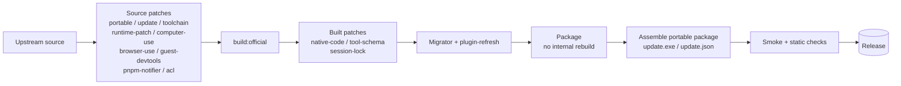

# DSH Build

[中文](README.md) | English

Portable Windows builds of [deepseek-harness](https://github.com/deepseek-ai/deepseek-harness): pulled, patched, built, smoke-tested, and released automatically, following upstream daily.
Downloads are in [Releases](https://github.com/citydirector/DSH-build/releases).

| Artifact | For |
|---|---|
| `dsh-desktop-win64-*.zip` | **Desktop (recommended)**: Electron window + bundled runtime, unzip and run |
| `dsh-portable-win64-*.zip` | Portable: no Electron, uses your browser, about half the size |
| `dsh-npm-tarballs-*.zip` | Every `@deepseek-ai/dsh` package as a tarball, for offline or self-hosted registries |

---

## What we change on top of upstream

Upstream ships installers, writes to the user profile, and has a few problems that only show up in a portable Windows package. This is **every** change this repo makes. Each one is its own script with a regression test, and each fails the build when its upstream anchor drifts, so nothing ships half-patched.

> Legend: 🟢 portable　🔵 desktop　·　**source** = patches upstream TS before the build　**built** = patches compiled lib after the build

### 1. Portable by design

| Change | Effect | Pkg | Script |
|---|---|---|---|
| All state inside the folder | `DSH_HOME` and Electron's userData / cache / logs live in `data/`; unset `XDG_*` variables point at `data/xdg/`, so XDG-following plugins (e.g. billion-context) stay inside too, and the Node process such plugins spawn is pinned to the bundled runtime (`BILLION_CONTEXT_NODE`). No registry, nothing in the user profile; delete the folder to uninstall | 🟢🔵 | `dsh-launcher.cs` · `patch-desktop-portable.mjs` (source) |
| No forced official update | Self-built desktop never polls Platform or shows the mandatory-update overlay; the package has no electron-updater feed | 🔵 | `patch-desktop-update.mjs` (source) |
| Directory build without installer toolchain | Skips the VS C++ Build Tools / Windows SDK checks and NSIS prep behind an env switch; upstream defaults unchanged | 🔵 | `patch-desktop-toolchain.mjs` (source) |

### 2. Updates and plugins

| Change | Effect | Pkg | Script |
|---|---|---|---|
| In-place updater | `update.exe` checks Releases, backs up, and replaces files in place, keeping `data/`; main / dev channels | 🟢🔵 | `dsh-updater.cs` |
| Glue-only updates still arrive | Besides the upstream commit in `VERSION`, packages carry this repo's fingerprint in `GLUE`, so patch, launcher, or updater fixes count as new versions | 🟢🔵 | `dsh-updater.cs` · `ci/` |
| **Plugins follow the runtime** | Before replacing files, checks profile plugins against the new runtime and finds compatible versions for the ones it would break; afterwards upgrades them through the official `dsh plugin add`, which rolls back on failure | 🟢🔵 | `plugin-refresh.mjs` · `dsh-updater.cs` |
| Manual plugin update | `update.exe --plugins` moves every plugin to its newest compatible version | 🟢🔵 | same |
| `dsh plugin` works in portable | Upstream's CLI expects pnpm on PATH; the portable package only had node, so `dsh plugin` always failed with "pnpm was not found". It now ships pnpm (upstream's version) | 🟢 | `dsh-plugin-cli.mjs` · `assemble-runtime.ps1` |
| No "new version available" nag from pnpm | The bundled pnpm's update-notifier phones home after `install` / `add` and suggests upgrading, but the shipped version is pinned to upstream and must not be bumped on its own (`12.x` fails `pnpm run` inside the workspace). Both pnpm entry points — portable `dsh plugin` and the desktop plugin panel — set `PNPM_CONFIG_UPDATE_NOTIFIER=false` | 🟢🔵 | `dsh-plugin-cli.mjs` · `patch-desktop-pnpm-notifier.mjs` (source) |
| Session migration v2/v3 → v4 | Upstream's migrator bundled into one file, run once per version on first start; skipped in milliseconds when everything is already v4 | 🟢🔵 | `build-migrator.mjs` · `dsh-launcher.cs` |

### 3. Official features, bundled

| Change | Effect | Pkg | Script |
|---|---|---|---|
| computer-use | Registry + Cua Driver native provider bundled; native libraries unpacked from asar with a fixed path mapping | 🟢🔵 | `patch-desktop-computer-use.mjs` (source) · `patch-dep.mjs` |
| browser-use | Registry + runtime + chrome-devtools-mcp provider bundled | 🟢🔵 | `patch-desktop-browser-use.mjs` (source) · `patch-dep.mjs` |
| DevTools for embedded pages | Packaged webview guests open their own DevTools with F12 / Ctrl+Shift+I (`DSH_DESKTOP_GUEST_DEVTOOLS=0` turns it off) | 🔵 | `patch-desktop-guest-devtools.mjs` (source) |

> Why bundle instead of installing into a profile: upstream plugins pin their peer to an **exact** version, so a profile copy fails the compatibility gate on every harness release. `check-peer-pins.mjs` keeps watching that constraint.

### 4. Bug fixes

| Problem | Fix | Pkg | Script |
|---|---|---|---|
| Messages don't render in the browser | Browsers print native `toString` over several lines, tripping the lossless-JSON guard; whitespace is normalized before comparing | 🟢🔵 | `patch-native-code.mjs` (built) |
| v2 sessions rejected by migration | Adds the historical kind `instruction-hint` to the v2→v3 allow-list, so batch migration rejects nothing | 🟢🔵 | `patch-native-code.mjs` (built) |
| Some model routes 400 on every request | Strips non-string enums from MCP tool schemas (such as cua's `enum:[true]`) that string-enum-only routes reject wholesale | 🟢🔵 | `patch-tool-schema.mjs` (built) |
| Session write lock stops excluding | The Windows named semaphore hashes the **reparse-resolved** path, so a DSH_HOME reached through a junction, subst drive, or link still locks | 🟢🔵 | `patch-session-lock.mjs` (built) |
| Every desktop sandbox command exits `0xC0000142` | Electron is a GUI-subsystem image, so the ACL sandbox runner has no console and the restricted child dies in DLL init; the runner now calls `AllocConsole` first | 🔵 | `patch-windows-acl-runner-console.mjs` (source) |

### 5. Build plumbing (invisible, but required)

| Change | Why | Script |
|---|---|---|
| Fill what deploy drops | `pnpm deploy` drops peer and registry deps between workspace packages and leaves symlinks that zipping loses; they are copied in **and declared** in the manifest, or plugin rows count as not installed | `patch-peers.mjs` · `patch-dep.mjs` |
| No internal rebuild during desktop packaging | Upstream packaging reruns `build:official` and would wipe built patches; it is switched off and the client build record recomputed | `patch-desktop-runtime-patch.mjs` (source) |
| Field repair tool | Fixes `0xC0000142` on an already-installed older desktop without reinstalling | `tools/repair-windows-acl-runner-console.mjs` |

### Where each patch lands



The portable build takes the `pnpm deploy` route: deploy → fill deps → built patches → compile `dsh.exe` / `update.exe` → real boot smoke + plugin-manager smoke.

---

## Using it

### Desktop

1. Unzip to a **short path** such as `D:\dsh-desktop`.
2. Run `DeepSeek Harness.exe` (Web UI on port 19387, so it does not clash with the portable build's 3080).
3. Enter your DeepSeek API key on first use.

Details (manifest-driven updates, static checks) are in [portable/README-desktop.md](portable/README-desktop.md).

### Portable

1. Unzip anywhere (avoid `C:\Program Files`).
2. Run `dsh.exe`; it starts the Web UI at `http://127.0.0.1:3080` and opens your browser.
3. Enter your DeepSeek API key on first use.

```
dsh-portable/
├── dsh.exe        # launcher: DSH_HOME=data, migrates sessions; `dsh plugin …` uses bundled pnpm
├── update.exe     # updater: in-place update + plugin refresh
├── node/          # Node.js runtime
├── app/           # dsh and its deps; vendor/pnpm, plugin-refresh.mjs
├── data/          # your data (kept across updates)
├── VERSION        # upstream commit sha
└── GLUE           # this repo's fingerprint
```

### Updating

Close dsh, then run `update.exe`:

1. It checks Releases; you're up to date only when both the upstream commit **and** `GLUE` match.
2. After download, it checks plugins with the new runtime. If one has no compatible version, press N to cancel, or any other key (or wait 10 seconds) to continue.
3. It backs up to `data/backups/` and replaces files in place, `update.exe` included.
4. It then upgrades the plugins that need it, and pauses if any upgrade failed.

| Command | Does |
|---|---|
| `update.exe --force` | Re-download and replace even when up to date |
| `update.exe --plugins` | Update plugins only, leave dsh alone |
| `dsh.exe plugin --profile <p> add <pkg>@<version>` | Install or upgrade a plugin by hand (portable) |
| `dsh.exe --migrate-sessions` | Re-run session migration (`DSH_SKIP_SESSION_MIGRATION=1` skips it) |

> ⚠️ Older builds cannot read sessions migrated to v4. The first update to a build with plugin refresh still runs the old `update.exe`, so refresh starts with the following update; run `--plugins` once in the meantime.

### Troubleshooting

- **Slow startup is almost always MCP, not sessions**: startup doesn't read sessions, but each MCP plugin waits for its server and retries with backoff (up to about 150 seconds per server). Add `disabled: true` to servers you rarely use and turn them on from the plugin panel (`patchReload: live` applies at once). `failOnStartupError: true` doesn't speed anything up. Servers started with `npx -y` start faster from a local path.
- **A bundle fails to load**: `node portable/check-bundles.mjs <install>\app\node_modules [--profile <profile>]` lists bundles your profile selects that the package doesn't ship (exit 0 clean / 1 dangling / 2 list unparsable).
- **A plugin got disabled**: run `update.exe --plugins`. If it still says incompatible, its author hasn't released a compatible version yet.

---

## Build and release

| | `dev` (default branch) | `main` |
|---|---|---|
| Purpose | Pre-release, follows upstream | Verified stable |
| Trigger | Daily 06:00 UTC + manual | Push to main + manual |
| Upstream | Head of `master` | `portable/upstream.pin` (reproducible) |
| Publishes to | `dsh-dev-latest` (pre-release) | `dsh-master-latest` |

- The channels differ only in where the upstream commit comes from; the glue is byte-identical. Scheduled runs skip only when both the upstream commit and the glue fingerprint are unchanged; manual runs always build.
- Promote by merging `dev` into `main`. Builds on one channel queue, so they never delete each other's release.
- Pipeline `.github/workflows/build-harness.yml`: `check` → `npm` / `portable` / `desktop` → `release` → `notify-failure`. The workflow only orchestrates; the logic lives in `ci/` and runs locally too.
- pnpm is not pinned by hand: `ci/align-package-manager.mjs` reads the upstream root `package.json`'s `devDependencies.pnpm` (Desktop's `primary-runtime` pnpm is copied from exactly that entry, so the build-time pnpm equals the shipped one), checks it against the forbidden range, and passes it to `pnpm/action-setup` through `$GITHUB_OUTPUT`. Forbidden: `<11.7.1` (hoisting bug, [pnpm#12880](https://github.com/pnpm/pnpm/issues/12880)) and `12.x` (fails `pnpm run` inside the workspace). Set `PNPM_VERSION` only to pin in an emergency — the script then warns that the build-time pnpm differs from the shipped one.
- Manual run: Actions → **Build DSH** → `Run workflow`, `channel` = `auto` / `main` / `dev`.
- ⚠️ Don't pin anything older than 0.1.7: those versions have no v3/v4 session codecs.

### Local

```powershell
npm test                            # all patch and tool tests
node portable/build-desktop.mjs     # desktop (--skip-build / --skip-package / --no-verify)
node portable/verify-desktop.mjs --dir <staged package>
node portable/check-peer-pins.mjs <upstream root>   # exact peer pin sentinel
```

### Writing a patch

- Source patches use `portable/lib/apply-edits.mjs`: declare `EDITS`; each anchor must match exactly once, and applying twice is a no-op.
- Each patch gets a regression test under `tests/`.
- Refer to upstream code by symbol name, never by line number.

## License

[MIT](LICENSE). Upstream deepseek-harness is also MIT.
