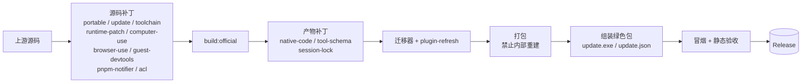

# DSH Build

中文 | [English](README.en.md)

[deepseek-harness](https://github.com/deepseek-ai/deepseek-harness) 的 Windows 绿色构建：每天跟随上游自动拉取、打补丁、构建、冒烟、发布。
下载见 [Releases](https://github.com/citydirector/DSH-build/releases)。

| 产物 | 适合谁 |
|---|---|
| `dsh-desktop-win64-*.zip` | **桌面端（推荐）**：Electron 窗口 + 内置运行时，解压即用 |
| `dsh-portable-win64-*.zip` | 便携版：不带 Electron，用系统浏览器，体积约一半 |
| `dsh-npm-tarballs-*.zip` | `@deepseek-ai/dsh` 全家桶 tarball，离线 / 自托管 registry |

---

## 相比上游，我们改了什么

上游只发安装器、默认写用户目录，也有几处在 Windows 绿色包里才会暴露的问题。下面是本仓库在上游之上做的**全部**改动，每一项都是独立脚本，有回归测试，锚点漂移就让构建失败，不会悄悄发出半成品。

> 图例：🟢 便携版　🔵 桌面端　·　**源码** = 构建前改上游 TS　**产物** = 构建后改已编译的 lib

### 1. 绿色便携化

| 改动 | 效果 | 包 | 脚本 |
|---|---|---|---|
| 数据全部放进程序目录 | `DSH_HOME`、Electron 的 userData / cache / logs 全部落在 `data/`；未设置的 `XDG_*` 指到 `data/xdg/`，遵循 XDG 的插件（如 billion-context）也留在包内，插件自起的 node 进程钉到随包运行时（`BILLION_CONTEXT_NODE`）；不写注册表、不写 C 盘用户目录，删目录即卸载 | 🟢🔵 | `dsh-launcher.cs` · `patch-desktop-portable.mjs`（源码） |
| 去掉官方强制更新 | 自建桌面端不轮询 Platform，不弹「必须更新」遮罩；产物里没有 electron-updater 来源 | 🔵 | `patch-desktop-update.mjs`（源码） |
| 只出目录、免安装器工具链 | 跳过 VS C++ Build Tools / Windows SDK 预检和 NSIS 准备步骤（加环境开关，不改上游默认行为） | 🔵 | `patch-desktop-toolchain.mjs`（源码） |

### 2. 更新与插件

| 改动 | 效果 | 包 | 脚本 |
|---|---|---|---|
| 原地更新器 | `update.exe` 查 Release、备份、原地覆盖，`data/` 不动；可切 main / dev 通道 | 🟢🔵 | `dsh-updater.cs` |
| 胶水更新也能送达 | 包里除上游提交号 `VERSION` 外还有本仓库指纹 `GLUE`，只改了补丁 / 启动器 / 更新器的版本也会被识别为新版 | 🟢🔵 | `dsh-updater.cs` · `ci/` |
| **插件跟着版本走** | 覆盖前用新运行时检查 profile 插件，给不兼容的插件找到兼容版本；覆盖后用官方 `dsh plugin add` 逐个升级，失败的由上游自动回滚 | 🟢🔵 | `plugin-refresh.mjs` · `dsh-updater.cs` |
| 手动更新插件 | `update.exe --plugins`：把所有插件升到兼容当前版本的最新版 | 🟢🔵 | 同上 |
| 便携版 `dsh plugin` 可用 | 上游 CLI 要求 PATH 上有 pnpm，便携版只带 node，所以 `dsh plugin` 一直报 "pnpm was not found"。现在随包带 pnpm（与上游同版本） | 🟢 | `dsh-plugin-cli.mjs` · `assemble-runtime.ps1` |
| 不再提示 pnpm 可升级 | 随包 pnpm 自带的 update-notifier 会在 `install` / `add` 后联网比对并提示升级，但随包版本跟上游钉死、不该被单方面顶掉（`12.x` 在工作区里跑 `pnpm run` 会失败）。两条 pnpm 入口——便携版 `dsh plugin` 与桌面端插件面板——都用 `PNPM_CONFIG_UPDATE_NOTIFIER=false` 关掉 | 🟢🔵 | `dsh-plugin-cli.mjs` · `patch-desktop-pnpm-notifier.mjs`（源码） |
| 会话格式自动迁移 v2/v3 → v4 | 把上游迁移脚本打成单文件随包分发，每个版本首次启动跑一次；已全部是 v4 时毫秒级跳过 | 🟢🔵 | `build-migrator.mjs` · `dsh-launcher.cs` |

### 3. 官方功能补全（随包发行）

| 改动 | 效果 | 包 | 脚本 |
|---|---|---|---|
| computer-use | 注册表 + Cua Driver 原生提供方随包，原生库解包出 asar 并修正路径映射 | 🟢🔵 | `patch-desktop-computer-use.mjs`（源码） · `patch-dep.mjs` |
| browser-use | 注册表 + 运行时 + chrome-devtools-mcp 提供方随包 | 🟢🔵 | `patch-desktop-browser-use.mjs`（源码） · `patch-dep.mjs` |
| 内嵌浏览器页的 DevTools | 打包版的 webview guest 也能用 F12 / Ctrl+Shift+I 打开自己的 DevTools（`DSH_DESKTOP_GUEST_DEVTOOLS=0` 可关） | 🔵 | `patch-desktop-guest-devtools.mjs`（源码） |

> 为什么要随包，而不是装进 profile：上游插件的 peer 是**精确版本**，装在 profile 里的副本每次 harness 升版都会被兼容门禁判为不兼容。`check-peer-pins.mjs` 一直盯着这条约束。

### 4. Bug 修复

| 问题 | 修复 | 包 | 脚本 |
|---|---|---|---|
| 浏览器里消息渲染不出来 | native 函数 `toString` 在浏览器里是多行输出，lossless-JSON 守卫因此误判；比较前先归一化空白 | 🟢🔵 | `patch-native-code.mjs`（产物） |
| v2 会话迁移被拒 | v2→v3 白名单补上历史 kind `instruction-hint`，批量迁移才能做到 0 拒绝 | 🟢🔵 | `patch-native-code.mjs`（产物） |
| 部分模型路由每次请求都 400 | 去掉 MCP 工具 schema 里的非字符串 enum（例如 cua 的 `enum:[true]`），只认字符串 enum 的路由就不会再整条拒绝 | 🟢🔵 | `patch-tool-schema.mjs`（产物） |
| 会话写锁失效 | Windows 命名信号量改为对**解析符号链接后的真实路径**取哈希；经 junction / subst / 链接的 DSH_HOME 也能互斥 | 🟢🔵 | `patch-session-lock.mjs`（产物） |
| 桌面端沙箱命令一律 `0xC0000142` | Electron 是 GUI 子系统，ACL 沙箱 runner 没有控制台，受限子进程在 DLL 初始化时就退出；现在 runner 会先 `AllocConsole` | 🔵 | `patch-windows-acl-runner-console.mjs`（源码） |

### 5. 构建适配（用户看不到，但缺了就装不上）

| 改动 | 原因 | 脚本 |
|---|---|---|
| 补齐 deploy 漏掉的依赖 | `pnpm deploy` 会漏掉 workspace 包之间的 peer 和 registry 依赖，还会把包装成符号链接（打 zip 时会丢）；补齐后**声明进清单**，否则插件行会被判为未安装 | `patch-peers.mjs` · `patch-dep.mjs` |
| 禁止桌面打包内部重建 | 上游打包会再跑一次 `build:official`，把产物补丁冲掉；关掉内部重建，并重算客户端构建记录 | `patch-desktop-runtime-patch.mjs`（源码） |
| 现场修复工具 | 已经装好的旧版桌面端，不重装就修掉 `0xC0000142` | `tools/repair-windows-acl-runner-console.mjs` |

### 补丁打在哪一步



便携版走 `pnpm deploy` 路线：deploy → 补依赖 → 产物补丁 → 编译 `dsh.exe` / `update.exe` → 真 boot 冒烟 + 插件管理冒烟。

---

## 使用

### 桌面端

1. 解压到**短路径**（如 `D:\dsh-desktop`）
2. 双击 `DeepSeek Harness.exe`（Web UI 端口 19387，与便携版的 3080 不冲突）
3. 首次使用时填 DeepSeek API key

更多细节（清单驱动的更新、静态验收项）见 [portable/README-desktop.md](portable/README-desktop.md)。

### 便携版

1. 解压到任意目录（不建议放在 C 盘程序目录）
2. 双击 `dsh.exe`，它会启动 Web UI（`http://127.0.0.1:3080`）并打开浏览器
3. 首次使用时填 DeepSeek API key

```
dsh-portable/
├── dsh.exe        # 启动器：DSH_HOME=data，首启迁移会话；`dsh plugin …` 走随包 pnpm
├── update.exe     # 更新器：原地更新 + 插件刷新
├── node/          # Node.js 运行时
├── app/           # dsh 本体与依赖；vendor/pnpm、plugin-refresh.mjs
├── data/          # 用户数据（更新时保留）
├── VERSION        # 上游 commit sha
└── GLUE           # 本仓库内容指纹
```

### 更新

先关闭 dsh，再双击 `update.exe`：

1. 查 Release，只有上游提交号**和** `GLUE` 都一致才算已是最新版本
2. 下载、解压后，用新运行时检查插件：如果有插件找不到兼容版本，按 N 取消，按其它键或等 10 秒继续
3. 备份到 `data/backups/`，然后原地覆盖（`update.exe` 也会一起更新）
4. 覆盖完成后自动升级需要升级的插件；有失败时会停住让你看到结果

| 命令 | 作用 |
|---|---|
| `update.exe --force` | 已是最新版本也重新下载并覆盖 |
| `update.exe --plugins` | 只更新插件，不动 dsh 本体 |
| `dsh.exe plugin --profile <p> add <包>@<版本>` | 便携版手动装 / 升级插件 |
| `dsh.exe --migrate-sessions` | 重跑会话迁移（`DSH_SKIP_SESSION_MIGRATION=1` 可跳过） |

> ⚠️ 会话迁移到 v4 之后，旧版构建读不了这些会话。第一次升到带插件刷新的版本时，用的还是旧的 `update.exe`，所以插件刷新从下一次更新开始生效；在那之前可以先手动跑一次 `--plugins`。

### 故障排查

- **启动慢，几乎总是 MCP，不是会话**：启动不读会话；每个 MCP 插件激活前都要等自己的服务器连上，连不上就退避重试（单台最坏约 150 秒）。不常用的服务器加 `disabled: true`，要用时在插件面板里开（`patchReload: live` 即时生效）。别用 `failOnStartupError: true` 来「加速」，它一样要等完重试。`npx -y` 起的服务器换成本地路径会更快。
- **某个 bundle 加载失败**：`node portable/check-bundles.mjs <安装目录>\app\node_modules [--profile <profile>]`，列出 profile 选中但包里没带的 bundle（退出码 0 干净 / 1 有悬空 / 2 名单解析失败）。
- **插件被停用**：运行 `update.exe --plugins`。如果仍然显示「不兼容」，说明作者还没发兼容版本。

---

## 构建与发布

| | `dev`（默认分支） | `main` |
|---|---|---|
| 定位 | 跟随上游的预发布通道 | 验证过的稳定通道 |
| 触发 | 每日 06:00 UTC + 手动 | main 被推进 + 手动 |
| 上游 | `master` 头 | `portable/upstream.pin`（可复现） |
| 发布到 | `dsh-dev-latest`（pre-release） | `dsh-master-latest` |

- 两个通道只差上游提交的来源，胶水逐字节相同。自动触发时，上游提交和胶水指纹都没变才跳过；手动触发一律构建。
- 晋升：把 `dev` 合进 `main`。同一通道的构建会排队串行，不会互相删 release。
- 流水线 `.github/workflows/build-harness.yml`：`check` → `npm` / `portable` / `desktop` → `release` → `notify-failure`。workflow 只做编排，逻辑在 `ci/` 下，可以本地单独跑。
- pnpm 版本不手写：`ci/align-package-manager.mjs` 读上游根 `package.json` 的 `devDependencies.pnpm`（桌面版 `primary-runtime` 里的 pnpm 正是从这份拷进去的，所以构建用的 pnpm 恒等于随包那份），校验禁区后经 `$GITHUB_OUTPUT` 交给 `pnpm/action-setup`。禁区：`<11.7.1` 有 hoisted 缺陷（[pnpm#12880](https://github.com/pnpm/pnpm/issues/12880)），`12.x` 在工作区跑 `pnpm run` 会失败。只有紧急钉版时才设 `PNPM_VERSION` 覆盖（脚本会警告：那会让构建用的 pnpm 与随包的不同版本）。
- 手动触发：Actions → **Build DSH** → `Run workflow`，`channel` 选 `auto` / `main` / `dev`。
- ⚠️ 别把 pin 退回 0.1.7 之前：那些版本没有 v3/v4 会话编解码。

### 本地

```powershell
npm test                            # 全部补丁与工具的单测
node portable/build-desktop.mjs     # 桌面端（--skip-build / --skip-package / --no-verify）
node portable/verify-desktop.mjs --dir <staged package>
node portable/check-peer-pins.mjs <上游根>   # 上游精确钉版哨兵
```

### 写新补丁

- 源码补丁用 `portable/lib/apply-edits.mjs`：只声明 `EDITS`，每个锚点必须恰好命中一次，幂等。
- 每个补丁在 `tests/` 下配一份回归测试。
- 注释里引用上游代码时写符号名，不写行号。

## 许可证

[MIT](LICENSE)。上游 deepseek-harness 同为 MIT。
